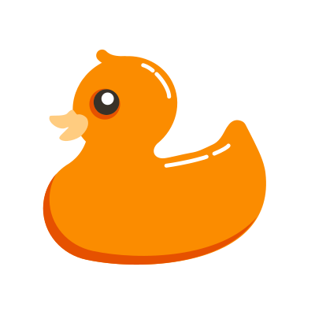

**[Gander Tools](https://gander-tools.github.io/)**

<table align="left"><tr><td align="center"><a href="https://github.com/gander"> Gander</a></td></tr></table>
<table align="left"><tr><td align="center"><a href="https://github.com/gander-tools"> Tools</a></td></tr></table>
<table align="left"><tr><td align="center"><a href="https://github.com/gander-pages"> Pages</a></td></tr></table>
<table align="left"><tr><td align="center"><a href="https://github.com/gander-labs"> Labs</a></td></tr></table>
<table align="left"><tr><td align="center"><a href="https://github.com/gander-actions"> Actions</a></td></tr></table>
<table align="left"><tr><td align="center"><a href="https://github.com/gander-apis"> APIs</a></td></tr></table>
<table align="left"><tr><td align="center"><a href="https://github.com/gander-data"> Data</a></td></tr></table>
<table align="left"><tr><td align="center"><a href="https://github.com/gander-mcp"> MCP</a></td></tr></table>
<table align="left"><tr><td align="center"><a href="https://github.com/gander-n8n"> n8n</a></td></tr></table>
<table align="left"><tr><td align="center"><a href="https://github.com/gander-schemas"> Schemas</a></td></tr></table>
<table align="left"><tr><td align="center"><a href="https://github.com/gander-settings"> Settings</a></td></tr></table>
<table align="left"><tr><td align="center"><a href="https://github.com/gander-skills"> Skills</a></td></tr></table>
<table align="left"><tr><td align="center"><a href="https://github.com/gander-templates"> Templates</a></td></tr></table>
<table align="left"><tr><td align="center"><a href="https://github.com/gander-scripts"> Scripts</a></td></tr></table>
<table align="left"><tr><td align="center"><a href="https://github.com/gander-containers"> Containers</a></td></tr></table>
<table align="left"><tr><td align="center"><a href="https://github.com/gander-examples"> Examples</a></td></tr></table>
<table align="left"><tr><td align="center"><a href="https://github.com/gander-archive"> Archive</a></td></tr></table>
<table align="left"><tr><td align="center"><a href="https://github.com/diff-voyager"><picture><source media="(prefers-color-scheme: dark)" srcset="https://raw.githubusercontent.com/diff-voyager/.github/refs/heads/main/assets/diff-voyager-dark.svg"></picture> Diff Voyager</a></td></tr></table>
 
